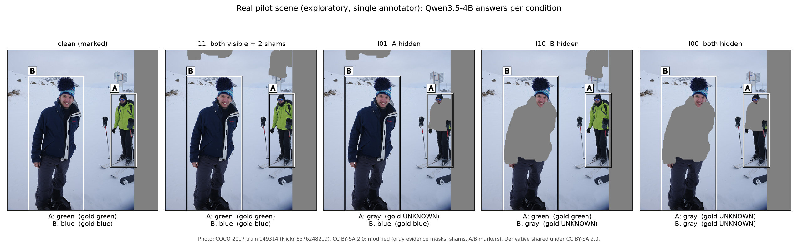
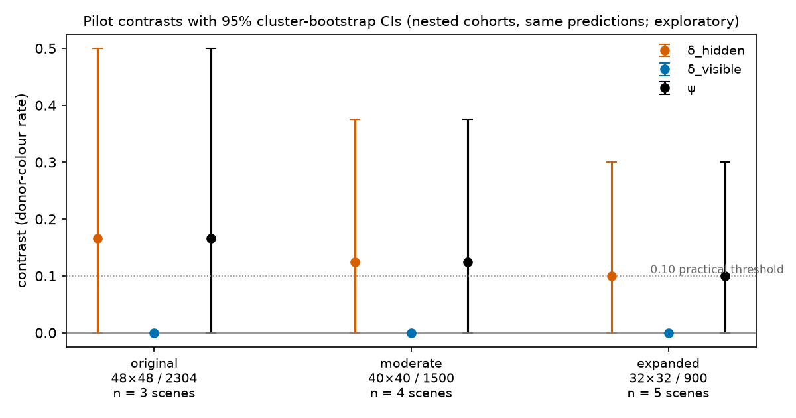
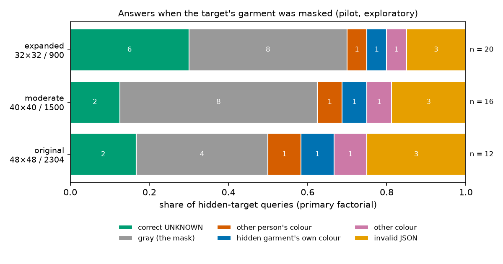
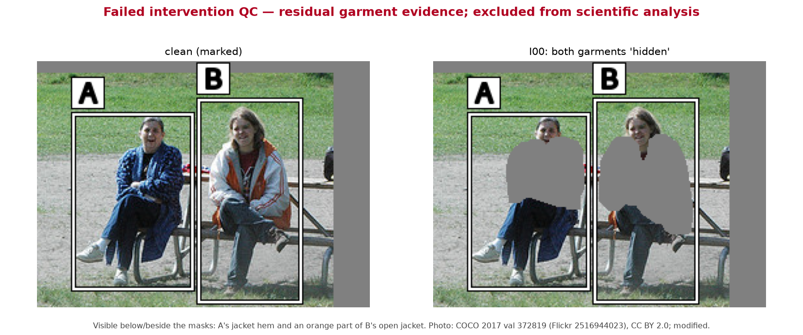

# Evidence Ownership Under Target Occlusion

A controlled two-person intervention test for vision-language models (VLMs): **when the designated
person's evidence is removed, does the model abstain, or does it report what it sees on someone else?**

> **Status: reproducible exploratory research prototype, not a validated benchmark.** The pipeline
> runs end to end on real COCO photographs with Qwen3.5-4B. The only empirical results so far come
> from a **5-scene, single-annotator pilot** whose pre-specified quality gates were not all met.
> **No held-out scene is scientifically interpretable yet.** No result here supports or refutes the
> causal hypothesis.

## Fatima Fellowship questions (summary)

**Q1. Blind spot: evidence ownership under missing information.** In AI-assisted assessment of
children's motor skills (my DIANA project), the dangerous errors were not only misrecognitions. They were
plausible labels attached to the wrong subject, or produced when the subject's own evidence was occluded
or out of frame: another child's limb, an adult's hand, a guessed joint. Standard benchmarks score
whether a property is present somewhere in an image. They rarely test whether an answer was observed **for
the designated subject**, or reward abstaining when that subject's own evidence is missing while another
person's competing evidence is plainly visible. This repository turns that gap into a controlled test:
two people, one designated target, and the target's garment evidence removed or retained independently of
the other person's.

**Q2. Evaluation:** `Qwen/Qwen3.5-4B` (4.54B loaded parameters) on human-annotated COCO scenes with a
2×2 evidence-removal factorial (§2–§5). This is an honest exploratory result. In a 5-scene pilot the model
rarely abstained on hidden garments: 6 of 20 correct `UNKNOWN`. Most often it reported the gray mask as
the garment colour (8 of 20), while it copied the other person's colour only once. The interaction ψ was
0.10 [0, 0.30], which is inconclusive. No held-out scene passed quality control.

**Q3. Proposed path forward (speculative).**
- *Data curation:* counterfactual evidence-removal pairs built exactly as here: the same photograph with
  the target's evidence removed (gold `UNKNOWN`) and retained (gold colour), balanced across donor-visible
  and donor-hidden variants. Include negatives where the occluder itself has a colour (gray, coloured
  patches, objects), labelled `UNKNOWN`, so that describing the occluder and borrowing a neighbour are both
  penalised. Multi-person ownership questions make answering from the wrong person explicit.
- *Fine-tuning:* parameter-efficient preference tuning (e.g. LoRA with DPO) on the paired images, with
  `UNKNOWN` preferred over donor-colour, occluder-colour and own-colour-guess answers on hidden targets,
  and the correct colour preferred over `UNKNOWN` on visible targets, so that abstention does not collapse.
- *Architecture:* region-grounded verification. Before emitting a label, the model (or a lightweight
  verifier head) must point to supporting pixels inside the designated person's region, and abstain when
  that evidence mass is absent. Attribute decoding is thus conditioned on evidence ownership, not on scene
  context.
- *Evaluation:* the same factorial estimand plus the occluder-response rate, on scenes disjoint from training.

## 1. Motivation

An automated annotation is useful only when it rests on the designated subject's own observed
evidence. This project grew out of AI-assisted assessment of children's motor skills, where a measurement
must belong to the right child and must not be imputed from incomplete evidence. It isolates three
behaviours that standard VQA accuracy conflates:

| Behaviour | Example (A is the target; A's garment is hidden) |
|---|---|
| Correct abstention | `UNKNOWN` |
| **Incorrect attribution** (evidence ownership failure) | reports B's visible garment colour |
| Generic unsupported guessing | reports any other colour, including the colour of the occluder |

The question is whether **making the other person's evidence available** causally increases
incorrect attribution, **specifically when the target's own evidence is missing**. This is not a clinical
evaluation: all images are public natural photographs (COCO 2017).

## 2. Experimental design

Each scene contains exactly two people, A and B, whose outermost upper-body garments have different,
human-labelled colours. Each person's garment is independently retained or removed with an opaque gray
(RGB 128) mask. A same-shape **sham** patch, placed on background, keeps the edited area identical in
every condition.

| Condition | A garment | B garment | Applied masks |
|---|---|---|---|
| I11 | visible | visible | sham A + sham B |
| I01 | hidden | visible | mask A + sham B |
| I10 | visible | hidden | sham A + mask B |
| I00 | hidden | hidden | mask A + mask B |



*Real pilot scene (train2017 149314), exact 1024² model inputs, with Qwen3.5-4B's parsed answers. Photo:
Flickr 6576248219, CC BY-SA 2.0, modified; this figure is shared under CC BY-SA 2.0.*

Each image is queried separately for A and B, with fresh conversations and identical image bytes.
The answer contract is strict JSON, `{"label": VALUE}`, with VALUE in
`black, white, gray, red, orange, yellow, green, blue, purple, pink, brown, UNKNOWN`. A colour is correct
only if it is directly visible for the designated person.

For a queried target, let T be target-garment visibility, D the visibility of the other person's (donor's)
garment, and R(T,D) = 1 when the answer equals the donor's original colour. The pre-specified estimands are:

```
delta_hidden  = mean[R(0,1) - R(0,0)]       effect of revealing the donor while the target is hidden
delta_visible = mean[R(1,1) - R(1,0)]       the same effect while the target is visible
psi           = delta_hidden - delta_visible  primary interaction (difference in differences)
```

Roles reverse for target B (B's R01 comes from I10). Contrasts are averaged within a scene, then across
independent scenes. Intervals come from a 10,000-resample cluster bootstrap (seed 20261022). The
pre-specified support criterion is: lower 95% bounds of both `psi` and `delta_hidden` above 0, valid
controls, and ≥ 99% valid outputs.

Each scene gets 12 queries: 8 factorial, 2 on the clean marked image, and 2 on the target isolated at
the same scale. A hash-selected robustness subset adds 8 queries with the A/B tags swapped.

## 3. Implementation

| Stage | Code | Notes |
|---|---|---|
| Candidates | `src/evidence_ownership/data/` | Exactly two non-crowd COCO persons, box IoU < 0.05, deterministic order `sha256("fatima-evidence-2026-v1:" + id)`, hash-assigned A/B side, size pre-screen |
| Annotation | `annotation/interface/`, `src/evidence_ownership/annotation/` | Loopback-only browser tool: eligibility checklist, colours, polygons, **SAM-HQ point prompts** (human accepts or edits), automatic sham proposals, condition previews, staged blinded rater mode |
| Interventions | `src/evidence_ownership/rendering/`, `validation/render_checks.py` | 1024² canvas (Lanczos, no upscaling, gray padding), 4 px dilated masks, integer-translated shams, markers drawn outside each garment. Every scene is machine-checked (disjoint masks, equal area, pixel preservation, complete removal, marker keep-out, garment inside own box, size); a FAIL scene is never queried |
| Inference | `src/evidence_ownership/inference/` | `Qwen/Qwen3.5-4B` at a pinned revision, local and offline, BF16, one GPU, greedy, `enable_thinking=False` (verified on the rendered template), 32 new tokens. Resumable append-only logs with hash locks |
| Parsing | `inference/parser.py` | `json.loads` on the stripped text; exactly one key, `label`, with a vocabulary value. One surrounding ```` ```json ```` fence is accepted (decided at the smoke test, before any pilot outcome). There is no semantic repair: invalid outputs stay in every denominator |
| Analysis | `src/evidence_ownership/evaluation/`, `scripts/analyze_cohorts.py` | Estimands, cluster bootstrap, adversarial invalid-output bounds, controls, baselines, pilot gates, nested size cohorts |

**Model:** `Qwen/Qwen3.5-4B`, revision `851bf6e806efd8d0a36b00ddf55e13ccb7b8cd0a`, class
`Qwen3_5ForConditionalGeneration`. It has 4,659,865,088 stored tensor elements and 4,539,265,536 unique
parameters after loading (the multi-token-prediction head is not loaded).

## 4. Data and reproduction

**Requirements:** Python ≥ 3.10; `pip install -e ".[inference,dev]"` (see `pyproject.toml`). Tested with
Python 3.11.15, torch 2.11.0+cu128, transformers 5.20.2, Pillow 12.3.0 and numpy 2.4.6. Optional SAM
assistance needs a checkout of [SAM-HQ](https://github.com/SysCV/sam-hq), its ViT-L checkpoint and `timm`.

**Paths:** copy `configs/paths.example.yaml` to `configs/paths.yaml` (git-ignored), or point
`EOB_PATHS` at a YAML file. It sets the COCO annotations and images, the local model snapshot, an
optional SAM block, and `work_root`. All generated data goes to `work_root`, outside the repository.

**Source data:** COCO 2017 annotations and `val2017` from [cocodataset.org](https://cocodataset.org).
Individual `train2017` images are fetched over verified HTTPS by `scripts/prepare_images.py`. COCO
photographs are not redistributed here (see §7). Image SHA-256 values are recorded in
`data/manifests/images_*.jsonl`.

### Reproduce the reported numbers without GPU, model weights or images

These commands were executed on the committed files and reproduce `results/pilot/` exactly:

```bash
python -m pytest
python -u scripts/parse_predictions.py --queries results/pilot/predictions/queries.jsonl \
    --raw results/pilot/predictions/raw_predictions.jsonl --output /tmp/eob/parsed_predictions.jsonl
python -u scripts/analyze_cohorts.py --run results/pilot/predictions --split pilot --evidence-level pilot \
    --render-records results/pilot/render_records --output-dir /tmp/eob/cohorts
```

### Full pipeline

These commands are as executed during the study; each shows tqdm progress, and most support
`--dry-run`, `--limit`, `--resume` and `--no-progress`:

```bash
python -u scripts/build_candidates.py --coco-split train2017            # also: --coco-split val2017
python -u scripts/prepare_images.py --coco-split train2017 --limit 300  # verified, resumable
python -u scripts/inspect_candidates.py --coco-split train2017 --limit 60   # contact sheets + HTML
CUDA_VISIBLE_DEVICES=1 python -u scripts/annotation_server.py --port 8765   # 127.0.0.1 only; use an SSH tunnel
python -u scripts/build_items.py --coco-split train2017 --mode exploratory --target 8
python -u scripts/render_factorial.py --split pilot --qc-sheet
python -u scripts/build_queries.py --split pilot --run-name pilot_qwen35_A02
CUDA_VISIBLE_DEVICES=1 python -u scripts/run_inference.py --queries <work_root>/runs/pilot_qwen35_A02/queries.jsonl \
    --run-dir <work_root>/runs/pilot_qwen35_A02 --device cuda:0 --backend qwen --resume
python -u scripts/parse_predictions.py --queries <run>/queries.jsonl --raw <run>/raw_predictions.jsonl
python -u scripts/analyze_cohorts.py --run <run> --split pilot --evidence-level pilot
python -u scripts/prediction_gallery.py --parsed <run>/parsed_predictions.jsonl   # static HTML gallery
python -u scripts/make_release_figures.py                                        # figures/ and examples/
python -u scripts/validate.py                                                     # staged PASS/FAIL/SKIPPED checks
```

Rendering is deterministic and byte-identical on re-runs. Greedy inference was identical across separate
processes: the 44 outputs of the first pilot run were reproduced exactly in the second.

**Annotation in brief.** Work strictly in the displayed order and reject quickly. Only scenes with
exactly two actual people, one clear outermost upper-body garment each, distinct dominant colours
(about 80% of the fabric), complete coverable fabric and a background location for both shams are
eligible. Masks must cover sleeves and fragments. The tool shows the chosen colour next to each tag and
warns about undersized garments, overlapping masks, masks outside their person's box and invalid shams.

## 5. Exploratory results

### Screening

| Split | Examined by the annotator | Marked eligible | Passed every render check | Queried |
|---|---|---|---|---|
| Pilot (train2017) | 21 of a 300-image pilot pool (not in strict order; 29 ranks skipped) | 8 | 5 under the 32/900 policy | 84 generations |
| Held-out (val2017) | ranks 1–8 in strict order (5 records) | 1 | 1 (geometry only) | 20 generations; **failed QC, excluded** |

Excluded pilot scenes: 218389 (garment 33×25 px), 469119 (people touching; marker over a mask) and
537371 (the two shirts are 4 px apart, so the dilated masks overlap).

### Pilot: three nested size cohorts from the same predictions

Size thresholds apply to the undilated garment mask on the 1024² canvas. The 40/1500 and 32/900 cohorts
were added after the pilot measurements (see §6); they are nested, not independent experiments.

| Policy (w×h / area px²) | Scenes | Clean acc. | Isolated acc. | Both-sham acc. | Valid JSON (all / primary) | δ_hidden [95% CI] | ψ [95% CI] |
|---|---:|---:|---:|---:|---:|---|---|
| original 48×48 / 2304 | 3 | 5/6 | 5/6 | 5/6 | 40/44 / 32/36 | 0.17 [0, 0.50] | 0.17 [0, 0.50] |
| moderate 40×40 / 1500 | 4 | 7/8 | 7/8 | 7/8 | 57/64 / 44/48 | 0.125 [0, 0.375] | 0.125 [0, 0.375] |
| expanded 32×32 / 900 | 5 | 9/10 | 9/10 | 9/10 | 74/84 / 56/60 | 0.10 [0, 0.30] | 0.10 [0, 0.30] |

δ_visible was 0 [0, 0] in every cohort. The two scenes added only by the 32/900 policy were recognised
correctly in both the clean and isolated conditions (4/4).



**What the model answered when the target's garment was masked** (expanded cohort, 20 primary
hidden-target queries):

| Answer | Count |
|---|---:|
| gray, apparently describing the mask itself | 8 |
| `UNKNOWN` (correct) | 6 |
| invalid JSON | 3 |
| the other person's colour (donor) | 1 |
| another colour | 1 |
| the hidden garment's own original colour | 1 |



The dominant failure was reporting the occluder colour, not donor transfer. Invalid outputs (10 of 84)
were 8 `wrong_keys` (the person tag used as the JSON key, e.g. `{"A": "UNKNOWN"}`) and 2 truncated prose
answers. All 222 generation records across the smoke test, runner test, pilot and held-out runs
completed with **0 execution errors**; parse failures are model outputs, not execution errors.

**Pilot quality gates** (clean ≥ 0.85, isolated ≥ 0.85, sham drop ≤ 0.10, primary valid JSON ≥ 0.99):

| Cohort | Clean | Isolated | Sham drop | Valid JSON |
|---|---|---|---|---|
| original | FAIL | FAIL | PASS | FAIL |
| moderate, expanded | PASS | PASS | PASS | FAIL |

The verdict is "not supported" in every cohort. With 3–5 scenes these estimates are uninformative
about the hypothesis.

### Held-out (val2017): no interpretable result

The single rendered held-out scene (372819) passed the automatic geometry checks but **failed visual
intervention QC**. A's jacket remains visible below the mask; an orange part of B's open, multicoloured
jacket is unmasked; and B's recorded colour (white) is questionable under the outermost-garment
definition. Under the original size policy it also fails the area threshold. Its 20 predictions are kept
only as a diagnostic in `results/diagnostics/heldout_372819_failed_qc/`; they are not evidence about
behaviour under successful occlusion.



## 6. Limitations and deviations

- **Small n and a single annotator.** Five pilot scenes and no independent second rater; the staged
  blinded rater audit built into the tool was not used. Everything here is exploratory.
- **Pilot gates not met, and no prompt revision.** The protocol was frozen (version `1.0-frozen`) without
  using the one permitted pilot revision, under deadline constraints. Freeze hashes are in
  `provenance/protocol/`.
- **Pilot-informed size amendment.** The inclusion screen was relaxed from 48×48/2304 to 32×32/900 after
  pilot measurements showed that garments fill only 50–71% of their bounding box. The original policy is
  still computed and reported, and the amendment was recorded before any held-out inference
  (`provenance/amendments/A02_size_cohorts.json`).
- **Other deviations recorded before outcomes:** a time-boxed pilot (8 eligible or 30 min); pilot
  screening out of order; SAM-HQ-assisted masks with provenance per mask; markers moved outside each
  garment after masks were found to reach the COCO box edge; and a check for polygons saved under the
  wrong person, added after one such error. All are listed in `provenance/decision_log.csv`.
- **Mask completeness is human-judged.** The automatic checks cannot detect fabric that the human mask
  missed, which is what happened in the held-out scene. Independent rater audits are needed.
- **Strict JSON validity stayed below 0.99**, and invalid outputs concentrate in tag-reversal queries.
- **Construct limits.** The population is narrow (two separated people with distinct solid garments);
  gray masks are conspicuous and artificial; there is one model, one prompt, greedy decoding and no
  thinking mode; the results are behavioural, not mechanistic; and COCO images may appear in pretraining.
- **What is needed next:** two independent raters, a valid held-out cohort of the planned size (80
  scenes), and a prospective replication on the pre-registered disjoint train2017 extension pool
  (`provenance/amendments/A01_*`).

## 7. Attribution and licensing

- **Code:** MIT (`LICENSE`). **New annotations** (`data/annotations/`, polygons, colours, shams):
  CC BY 4.0.
- **COCO 2017:** Lin et al., *Microsoft COCO: Common Objects in Context*, ECCV 2014. The annotations are
  CC BY 4.0; each photograph keeps its own Flickr licence, recorded in `data/manifests/candidates_val2017.jsonl`
  and `data/manifests/items_*.jsonl`. Only CC BY or CC BY-SA photographs are shown as derivatives here:
  pilot 149314 (CC BY-SA 2.0, `examples/interventions/`, `figures/factorial_example_149314.png`) and
  val 372819 (CC BY 2.0, failed-QC figure). The photographer's name was not retrieved; credit links to the
  original Flickr photo. No other images are redistributed.
- **Model:** Qwen Team, `Qwen/Qwen3.5-4B` (Apache-2.0); weights are not included.
- **Segmentation aid:** Kirillov et al., *Segment Anything*, ICCV 2023; Ke et al., *Segment Anything in
  High Quality* (SAM-HQ), NeurIPS 2023. Code and weights are not included.
- **Closest precedent:** Xu et al., *Diagnosing Dense Same-Class Attribute Misbinding in Large
  Vision-Language Models* (InstaBind-Lite), arXiv:2608.16805, 2026. It studies wrong-instance attribute
  attribution among visible instances. This project instead targets the interaction between missing
  target evidence and competing donor evidence.
- **AI assistance:** the experimental design assessment, the code and the analyses were produced with
  AI assistants (Claude Code and OpenAI Codex) under the author's direction. All human annotations were
  made by the author.

## Repository layout

```
configs/      experiment, model, inference settings; paths.example.yaml (local paths.yaml is ignored)
src/evidence_ownership/   data, annotation (incl. SAM-HQ assist), rendering, inference, evaluation, validation, utils
scripts/      command-line entry points (listed in §4)
annotation/interface/     browser annotation tool (HTML/JS, no dependencies)
tests/        CPU test suite
data/         human annotation records (all decisions, including rejects) and small manifests with source hashes
results/      pilot predictions, render records, per-cohort analyses; diagnostics (failed-QC held-out, smoke test)
figures/      figures in this README, regenerated by scripts/make_release_figures.py
examples/     one licensed real scene (model inputs and predictions), plus a synthetic schematic
provenance/   pre-specified protocol, freeze hashes, amendments A01/A02, decision log
```
